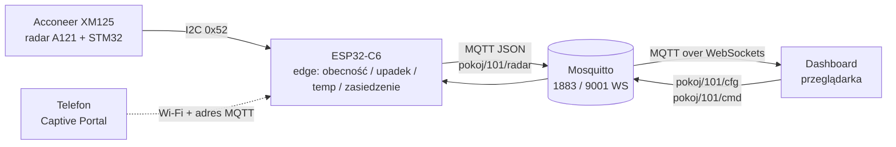

<div align="center">


# Presence Radar

**Radarowy system wykrywania obecności, upadków i zasiedzenia**
na **ESP32-C6** + **Acconeer XM125 (A121)**, z panelem w przeglądarce przez MQTT.


<!-- ===== ZDJĘCIE GŁÓWNE (hero) =====
     Wrzuć plik jako docs/img/main.png (najlepiej ~1600x900, np. urządzenie + panel obok siebie) -->
[obraz main]


</div>

---

## Co to jest

Firmware dla **ESP32-C6**, które czyta radar **XM125** po I2C, liczy lokalnie (*edge computing*)
czy w pokoju ktoś jest, czy się przewrócił, siedzi bez ruchu zbyt długo albo czujnik się przegrzewa,
i publikuje wynik jako JSON do brokera **MQTT**. Statyczny **dashboard** w przeglądarce pokazuje
karty pokoi na żywo, rysuje wykresy i alarmuje dźwiękiem.

Nic nie jest zaszyte w kodzie: Wi-Fi i adres brokera wpisujesz z telefonu przez **Captive Portal**,
a parametry radaru i progi alarmów zmieniasz **z panelu, w locie**, bez reflashu.

## Funkcje

| | |
| :-- | :-- |
| 🧍 **Obecność** | Wykrywanie osoby, odległość [mm], energia ruchu szybkiego (*mikro*) i wolnego (*makro*) |
| 🆘 **Upadek** | Gwałtowny ruch blisko podłogi |
| 🪑 **Zasiedzenie** | Obecność bez wyraźnego ruchu przez długi czas |
| 🔥 **Przegrzanie** | Alarm po przekroczeniu temperatury chipa |
| 📶 **Captive Portal** | Konfiguracja Wi-Fi + MQTT z telefonu, automatyczny popup, reset przyciskiem |
| 🎛️ **Konfiguracja z panelu** | Parametry radaru (strefa, czułość, filtry) i progi alarmów przez MQTT, zapis w NVS |
| 🖥️ **Dashboard** | Karty pokoi, wykresy, tryb OFFLINE, alarm dźwiękowy + czerwony baner |
| 💡 **Sygnalizacja** | RGB WS2812 + dioda + buzzer pokazują stan urządzenia |

---

## Zdjęcia

<table>
  <tr>
    <td align="center" width="50%">
      <!-- Wrzuć jako docs/img/panel.png (zrzut ekranu dashboardu) -->
      [zdjecie panelu]<br>
      
      <br><sub><b>Panel</b> - karty pokoi, wykresy, alarmy</sub>
    </td>
    <td align="center" width="50%">
      <!-- Wrzuć jako docs/img/urzadzenie.jpg (zdjęcie prototypu) -->
      [zdjecie urzadzenia]<br>
      
      <br><sub><b>Urządzenie</b> - ESP32-C6 + XM125 na PCB</sub>
    </td>
  </tr>
</table>

> 💡 W repo są już robocze grafiki w `docs/raport/img/`: `dashboard.png`, `urzadzenie.jpg`,
> `captive_portal.jpg`, `schemat_ideowy.png`, `pcb_layout.png`. Możesz je skopiować do `docs/img/`
> pod nazwami powyżej.

---

## Architektura



### Tematy MQTT

| Temat | Kierunek | Retained | Opis |
| :-- | :-- | :-: | :-- |
| `pokoj/101/radar` | radar → panel | ✔ | Wynik pomiaru + alarm |
| `pokoj/101/cfg` | panel → radar | ✔ | Delty konfiguracji (`radar:{...}`, `edge:{...}`) |
| `pokoj/101/cfg/state` | radar → panel | ✔ | Stan raportowany, z niego panel wypełnia formularz |
| `pokoj/101/cmd` | panel → radar | | Polecenia (np. `{"armed":true}` uzbrojenie alarmu) |
| `pokoj/101/status` | radar → panel | ✔ | `{"st":"online"/"offline"}` (LWT) |

Przykładowa ramka z `pokoj/101/radar`:

```json
{"obecnosc": 1, "odleglosc": 2310, "mikro": 1450, "makro": 220, "temp": 41, "alarm": "OK"}
```

`alarm` ∈ `OK` / `POZAR` / `UPADEK` / `ZASIEDZENIE`. Publikacja co **2 s**, a przy alarmie ≠ `OK` natychmiast.

---

## Szybki start

> Linux (Fedora/Ubuntu). Target to **ESP32-C6** (RISC-V), nie domyślny ESP32.

```bash
# 1. ESP-IDF (w każdym nowym terminalu)
. $HOME/main/tools/esp-idf/export.sh

# 2. Build + flash + monitor (z korzenia projektu, nie z main/)
idf.py set-target esp32c6          # raz na świeży katalog build
idf.py -p /dev/ttyACM0 build flash monitor     # wyjście: Ctrl+]

# 3. Broker + dashboard
mosquitto -c mosquitto.conf -v
firefox dashboard/index.html       # bez serwera HTTP
```

Skrót: `./quickstart.sh` startuje Mosquitto, ładuje ESP-IDF i otwiera dashboard.

**Pierwsze uruchomienie:** urządzenie stawia otwarty hotspot **`Konfiguracja_Radaru`**
(`192.168.4.1`). Połącz się telefonem, portal otworzy się sam (inaczej wejdź na
`http://192.168.4.1`), wpisz SSID, hasło i adres brokera (np. `mqtt://10.42.0.1:1883`).
Urządzenie zrestartuje się i zacznie publikować.

**Reset konfiguracji:** przytrzymaj przycisk (GPIO9) ok. 3 s. LED mrugnie 3×, buzzer piknie,
NVS zostanie wyczyszczone i urządzenie wróci do portalu. Reflash niepotrzebny.

---

## Sprzęt

<details open>
<summary><b>Podłączenie</b></summary>

Najważniejszy jest pin **WAKE_UP**: bez podciągnięcia do 3.3V STM32 na module śpi i na I2C
odpowiada samymi zerami, co łatwo pomylić z błędem okablowania.

| ESP32-C6 | Moduł / element | Opis |
| :-- | :-- | :-- |
| **5V / VBUS** | Radar 5V | Zasilanie |
| **GND** | Radar GND | Masa |
| **GPIO 2** | Radar SDA | I2C dane |
| **GPIO 11** | Radar SCL | I2C zegar |
| **3.3V** | Radar WAKE_UP | **KRYTYCZNE:** budzi STM32 z Deep Sleep |
| GPIO 10 | Radar INT | Zarezerwowane, na razie nieużywane |
| GPIO 8 | RGB WS2812 | Wbudowany na DevKitC-1 |
| GPIO 18 | LED | Dioda alarmowa na PCB, miga razem z RGB |
| GPIO 9 | Przycisk | Do GND, wewn. pull-up |
| GPIO 3 | Buzzer | Sygnał dźwiękowy |

Wszystkie piny są w jednym miejscu: `main/board_pins.h`.
Schemat i PCB (KiCad) leżą w `hardware/radar_xm125_esp32c6/`.

</details>

<details>
<summary><b>Wgranie firmware na radar (STM32)</b></summary>

STM32 na module musi działać jako serwer I2C „Presence Detector”. Wgrywasz go
narzędziem **Acconeer Exploration Tool**.

```bash
mkdir -p ~/main/tools && cd ~/main/tools
python3 -m venv .venv && source .venv/bin/activate
pip install "acconeer-exptool[app]"
python -m acconeer.exptool.app
```

1. Tryb bootloadera: trzymaj `BOOT`, kliknij `RST`, puść `BOOT`.
2. Zakładka **Flash**, wybierz port (np. `/dev/ttyACM0`, w razie pustej listy „Show all devices”).
3. Wgraj `i2c_presence_detector`.

Test radaru na PC (opcjonalnie): układ CH342 daje dwa porty, użyj **drugiego**,
ustaw baudrate `921600`, zresetuj moduł i kliknij *Start Measurement*.

</details>

---

## Protokół I2C radaru

XM125 to I2C **slave** pod adresem **`0x52`**: adresy rejestrów **16-bitowe** (MSB first),
wartości **32-bitowe big-endian**, każdy odczyt/zapis to **wielokrotność 4 bajtów**.

| Hex | R/W | Opis |
| :-- | :-: | :-- |
| `0x0000` | R | Wersja firmware. Same zera ⇒ **WAKE_UP nie podłączony** |
| `0x0003` | R | Status detektora (`0xFF` = gotowy, nie wystartowany) |
| `0x0010` | R | Pierwszy z 4 rejestrów wyniku |
| `0x0100` | W | Komendy: `1` = apply config, `2` = start, `3` = stop |

Start: wyślij `1` (apply) i `2` (start) pod `0x0100`. Odczyt: z `0x0010` czytamy 16 bajtów:

| Bajty | Pole | Znaczenie |
| :-- | :-- | :-- |
| 0-3 | `presence_reg` | bit 0 = obecność, **górne 16 bitów = temperatura chipa** |
| 4-7 | `distance_mm` | odległość [mm] |
| 8-11 | `intra_score` | energia ruchu szybkiego (gesty, upadek) |
| 12-15 | `inter_score` | energia ruchu wolnego (nieruchoma obecność, oddech) |

Pełny opis parametrów konfiguracji radaru (z zakresami i wpływem na działanie):
[`docs/parametry_radaru.md`](docs/parametry_radaru.md).

---

## Logika alarmów

Klasyfikator działa w pętli co 250 ms. Progi ustawiasz **z panelu** (temat `pokoj/101/cfg`, sekcja `edge`),
wartości trafiają do NVS.

| Parametr | Domyślnie | Zakres | Opis |
| :-- | :-: | :-: | :-- |
| `podloga_mm` | 2500 | 1000-6000 | Odległość radar → podłoga [mm] |
| `prog_upadku` | 1500 | 0-5000 | Min. `intra_score` dla upadku |
| `max_temp_c` | 20 | 0-90 | Próg temperatury [°C] (niski = demo; do pracy ustaw ~60) |
| `zasiedzenie_s` | 300 | 10-3600 | Czas nieruchomej obecności do alarmu [s] |

- **`POZAR`**: `temp > max_temp_c`
- **`UPADEK`**: `intra_score > prog_upadku` **oraz** `distance_mm > podloga_mm - 400`
- **`ZASIEDZENIE`**: obecność z niskim `intra` i wysokim `inter` przez `zasiedzenie_s`
- **`OK`**: reszta

Po stronie dashboardu działa też przełącznik **Alarm**: dźwięk (Web Audio) i czerwony baner,
gdy nikogo nie ma pod czujnikiem albo znika łączność (brak danych > 10 s ⇒ karta **OFFLINE**).

---

## Struktura projektu

```
presence_radar/
├── main/
│   ├── main.c             # app_main: I2C, pętla radaru, klasyfikator alarmów, MQTT
│   ├── radar.c / .h       # warstwa I2C radaru XM125
│   ├── radar_cfg.c / .h   # model konfiguracji radaru (write-all, zakresy, defaulty)
│   ├── edge_cfg.c / .h    # progi edge-logiki (NVS, walidacja)
│   ├── wifi_mqtt.c / .h   # Wi-Fi (STA/SoftAP), NVS, klient MQTT
│   ├── captive_portal.c   # portal konfiguracji HTTP
│   ├── dns_server.c / .h  # DNS przekierowujący na portal
│   ├── status_led.c / .h  # sygnalizacja RGB + dioda
│   └── board_pins.h       # jedyne miejsce z numerami pinów
├── dashboard/             # panel (index.html, mqtt.min.js, chart.js)
├── docs/                  # parametry radaru, prezentacja, raport końcowy (LaTeX + PDF)
├── hardware/              # projekt KiCad (schemat, PCB)
├── examples/              # skanery I2C itp. (poza buildem)
├── mosquitto.conf         # porty 1883 + 9001 (WebSockets)
├── quickstart.sh          # broker + ESP-IDF + dashboard jednym poleceniem
└── CMakeLists.txt         # top-level (idf.py odpalaj stąd)
```

Plany i znane ograniczenia: [`TODO.md`](TODO.md).

---

## Rozwiązywanie problemów

<details>
<summary><code>Permission denied</code> na <code>/dev/ttyACM0</code></summary>

```bash
sudo chmod 666 /dev/ttyACM0
```
</details>

<details>
<summary>Błędy CMake (<code>Unknown CMake command</code>)</summary>

`idf.py` odpalony z złego katalogu. Uruchamiaj z korzenia projektu, nie z `main/`.
W razie kryzysu: `rm -rf build/`.
</details>

<details>
<summary>I2C zwraca same zera</summary>

STM32 śpi. Połącz pin **WAKE_UP** z **3.3V** ESP32.
</details>

<details>
<summary>Dziwne odległości (np. <code>4008635904 mm</code>) lub brak reakcji na ruch</summary>

Antena nie wystartowała. Sprawdź, czy poszła komenda START (`2`) do `0x0100`. Wysłanie `3` zatrzymuje detektor.
</details>

<details>
<summary>Telefon nie pokazuje strony konfiguracji</summary>

Wejdź ręcznie na `http://192.168.4.1`. Jeśli hotspot się nie pojawia, w NVS są już dane: przytrzymaj przycisk ~3 s.
</details>

<details>
<summary>Brak publikacji MQTT mimo działającego radaru</summary>

MQTT czeka na pełne połączenie z Wi-Fi. Pętla „Rozłączono… próba ponownego połączenia” w logu
oznacza złe SSID/hasło (zresetuj konfigurację) albo nieosiągalny broker.
</details>

---

## Linki

- [Waveshare A121 Range Sensor](https://www.waveshare.com/wiki/A121_Range_Sensor#Documents)
- [Wideo poglądowe](https://www.youtube.com/watch?v=Puh9MMC1Ft0)
- [Acconeer Exploration Tool](https://docs.acconeer.com/en/latest/exploration_tool/index.html)
- [Datasheet ESP32-C6-WROOM-1](https://documentation.espressif.com/esp32-c6-wroom-1_wroom-1u_datasheet_en.html#pcb_layout_recommendations)
- [ESP-IDF I2C API](https://docs.espressif.com/projects/esp-idf/en/stable/api-reference/peripherals/i2c.html)
