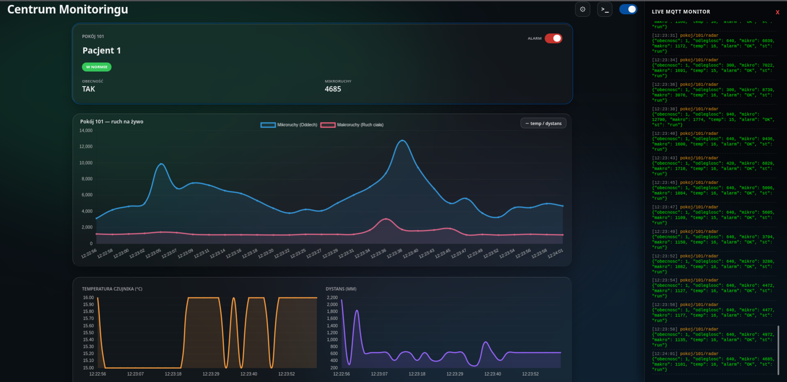
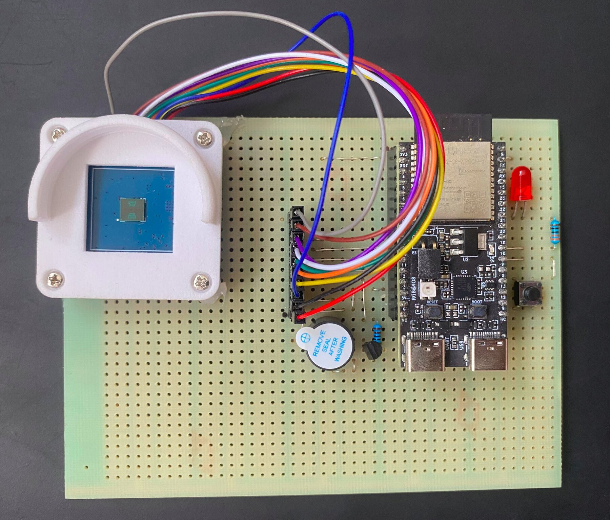
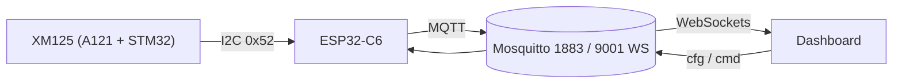

<div align="center">


# Presence Radar

Radarowy czujnik obecności, upadków i zasiedzenia.
ESP32-C6 + Acconeer XM125 (A121), MQTT, panel w przeglądarce.

<!-- Plik: docs/img/main.png -->


</div>

---

## Opis

Firmware ESP-IDF dla ESP32-C6 odczytuje radar XM125 przez I2C, lokalnie klasyfikuje
zdarzenia (obecność, upadek, zasiedzenie, przegrzanie) i publikuje wynik w JSON do brokera MQTT.
Dashboard w przeglądarce (MQTT over WebSockets) wyświetla stan pokoi na żywo.

- Wi-Fi i adres brokera ustawiane przez Captive Portal, zapis w NVS.
- Parametry radaru i progi alarmów zmieniane z panelu przez MQTT, bez ponownego wgrywania firmware.
- Sygnalizacja stanu: LED RGB (WS2812), dioda na PCB, buzzer.

<table>
  <tr>
    <td align="center" width="50%">
      <!-- Plik: docs/img/panel.png -->
      <br>
      
    </td>
    <td align="center" width="50%">
      <!-- Plik: docs/img/urzadzenie.jpg -->
      [zdjecie urzadzenia]<br>
      
    </td>
  </tr>
</table>

## Architektura



### Tematy MQTT

| Temat | Kierunek | Retained | Zawartość |
| :-- | :-- | :-: | :-- |
| `pokoj/101/radar` | urządzenie → panel | tak | Pomiar i alarm |
| `pokoj/101/cfg` | panel → urządzenie | tak | Zmiany konfiguracji (`radar`, `edge`) |
| `pokoj/101/cfg/state` | urządzenie → panel | tak | Stan raportowany konfiguracji |
| `pokoj/101/cmd` | panel → urządzenie | tak | Polecenia, np. `{"armed":true}` |
| `pokoj/101/status` | urządzenie → panel | tak | `{"st":"online"}` / `{"st":"offline"}` (LWT) |

Przykład ramki `pokoj/101/radar`:

```json
{"obecnosc": 1, "odleglosc": 2310, "mikro": 1450, "makro": 220, "temp": 41, "alarm": "OK"}
```

`alarm`: `OK`, `POZAR`, `UPADEK`, `ZASIEDZENIE`. Publikacja co 2 s, przy alarmie natychmiast.

## Uruchomienie

Wymagania: Linux, ESP-IDF (`~/main/tools/esp-idf`), Mosquitto. Target: **ESP32-C6**.

```bash
. $HOME/main/tools/esp-idf/export.sh        # w każdym nowym terminalu
idf.py set-target esp32c6                   # raz na świeży katalog build
idf.py -p /dev/ttyACM0 build flash monitor  # wyjście z monitora: Ctrl+]

mosquitto -c mosquitto.conf -v              # broker (1883 + 9001 WS)
firefox dashboard/index.html                # panel, bez serwera HTTP
```

`idf.py` uruchamiaj z korzenia projektu, nie z `main/`.

### Pierwsza konfiguracja

1. Przy pustym NVS urządzenie uruchamia otwartą sieć `Konfiguracja_Radaru` (`192.168.4.1`).
2. Połącz się z nią telefonem. Portal otworzy się automatycznie, w przeciwnym razie wejdź na `http://192.168.4.1`.
3. Podaj SSID, hasło i adres brokera (np. `mqtt://10.42.0.1:1883`). Urządzenie zrestartuje się i połączy.

Reset konfiguracji: przytrzymaj przycisk (GPIO 9) przez ok. 3 s. Dane sieci i MQTT zostaną usunięte z NVS, urządzenie wróci do portalu.

## Sprzęt

| ESP32-C6 | Radar / element | Uwagi |
| :-- | :-- | :-- |
| 5V | 5V | Zasilanie |
| GND | GND | Masa |
| GPIO 2 | SDA | I2C |
| GPIO 11 | SCL | I2C, 100 kHz |
| 3.3V | WAKE_UP | **Wymagane.** Bez tego STM32 śpi, a I2C zwraca same zera |
| GPIO 10 | INT | Niewykorzystane |
| GPIO 8 | WS2812 | LED RGB na płytce DevKitC-1 |
| GPIO 18 | LED | Dioda alarmowa |
| GPIO 9 | Przycisk | Do GND, pull-up wewnętrzny |
| GPIO 3 | Buzzer | |

Piny zdefiniowane w `main/board_pins.h`. Schemat i PCB (KiCad): `hardware/radar_xm125_esp32c6/`.

### Firmware radaru (STM32)

Moduł musi działać jako serwer I2C „Presence Detector”. Wgranie narzędziem Acconeer Exploration Tool:

```bash
python3 -m venv .venv && source .venv/bin/activate
pip install "acconeer-exptool[app]"
python -m acconeer.exptool.app
```

1. Tryb bootloadera: przytrzymaj `BOOT`, naciśnij `RST`, puść `BOOT`.
2. Zakładka **Flash**, wybierz port (`/dev/ttyACM0`), wgraj [`firmware/xm125/i2c_presence_detector.bin`](firmware/xm125/i2c_presence_detector.bin).

## Protokół I2C

Adres `0x52`. Rejestry 16-bitowe (MSB first), wartości 32-bitowe big-endian, transfery w wielokrotnościach 4 bajtów.

| Rejestr | R/W | Opis |
| :-- | :-: | :-- |
| `0x0000` | R | Wersja firmware (same zera: brak WAKE_UP) |
| `0x0003` | R | Status detektora (`0xFF`: gotowy, niewystartowany) |
| `0x0010` | R | Wynik: 4 × u32 (16 bajtów) |
| `0x0100` | W | Komenda: `1` apply config, `2` start, `3` stop |

Inicjalizacja: `1`, następnie `2` do `0x0100`. Odczyt z `0x0010`:

| Bajty | Pole | Znaczenie |
| :-- | :-- | :-- |
| 0-3 | `presence_reg` | bit 0: obecność; bity 16-31: temperatura chipa |
| 4-7 | `distance_mm` | Odległość [mm] |
| 8-11 | `intra_score` | Energia ruchu szybkiego |
| 12-15 | `inter_score` | Energia ruchu wolnego |

Parametry konfiguracji radaru: [`docs/parametry_radaru.md`](docs/parametry_radaru.md).

## Logika alarmów

Klasyfikacja co 250 ms. Progi (sekcja `edge` w `pokoj/101/cfg`) zapisywane w NVS.

| Parametr | Domyślnie | Zakres | Opis |
| :-- | :-: | :-: | :-- |
| `podloga_mm` | 2500 | 1000-6000 | Odległość radar-podłoga [mm] |
| `prog_upadku` | 1500 | 0-5000 | Minimalny `intra_score` dla upadku |
| `max_temp_c` | 20 | 0-90 | Próg temperatury [°C]; 20 to wartość demonstracyjna |
| `zasiedzenie_s` | 300 | 10-3600 | Czas obecności bez ruchu do alarmu [s] |

| Alarm | Warunek |
| :-- | :-- |
| `POZAR` | `temp > max_temp_c` |
| `UPADEK` | `intra_score > prog_upadku` i `distance_mm > podloga_mm - 400` |
| `ZASIEDZENIE` | Obecność z niskim `intra` i wysokim `inter` przez `zasiedzenie_s` |
| `OK` | Pozostałe przypadki |

Dashboard: przełącznik **Alarm** uzbraja sygnał dźwiękowy i baner przy braku obecności lub utracie łączności.
Brak danych dłuższy niż 10 s oznacza stan OFFLINE karty pokoju.

## Struktura

```
main/
  main.c            pętla radaru, klasyfikator alarmów, MQTT
  radar.c           warstwa I2C XM125
  radar_cfg.c       model konfiguracji radaru
  edge_cfg.c        progi alarmów (NVS)
  wifi_mqtt.c       Wi-Fi (STA/SoftAP), NVS, klient MQTT
  captive_portal.c  portal konfiguracji
  dns_server.c      DNS przekierowujący na portal
  status_led.c      sygnalizacja LED
  board_pins.h      definicje pinów
dashboard/          panel (index.html)
docs/               dokumentacja i raport końcowy
firmware/xm125/     gotowy firmware STM32 radaru (.bin)
hardware/           projekt KiCad
examples/           narzędzia pomocnicze (poza buildem)
mosquitto.conf      porty 1883 i 9001
quickstart.sh       broker + ESP-IDF + dashboard
```

Plany i ograniczenia: [`TODO.md`](TODO.md).

## Rozwiązywanie problemów

| Objaw | Przyczyna / rozwiązanie |
| :-- | :-- |
| `Permission denied` na `/dev/ttyACM0` | `sudo chmod 666 /dev/ttyACM0` |
| Błędy CMake | `idf.py` uruchomiony poza korzeniem projektu; ewentualnie `rm -rf build/` |
| I2C zwraca same zera | WAKE_UP niepodłączony do 3.3V |
| Odległości rzędu `4008635904` lub brak reakcji | Radar nie wystartował; sprawdź komendę `2` do `0x0100` |
| Brak strony konfiguracji | Wejdź na `http://192.168.4.1`; brak hotspotu oznacza dane w NVS, wykonaj reset przyciskiem |
| Brak publikacji MQTT | Błędne SSID/hasło lub nieosiągalny broker; sprawdź log szeregowy |

## Źródła

- [Waveshare A121 Range Sensor](https://www.waveshare.com/wiki/A121_Range_Sensor#Documents)
- [Acconeer Exploration Tool](https://docs.acconeer.com/en/latest/exploration_tool/index.html)
- [ESP32-C6-WROOM-1 datasheet](https://documentation.espressif.com/esp32-c6-wroom-1_wroom-1u_datasheet_en.html)
- [ESP-IDF I2C API](https://docs.espressif.com/projects/esp-idf/en/stable/api-reference/peripherals/i2c.html)
